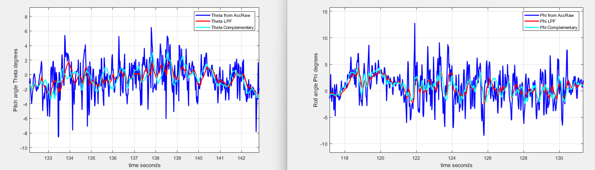
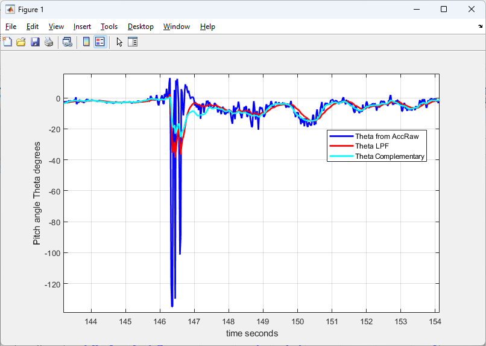
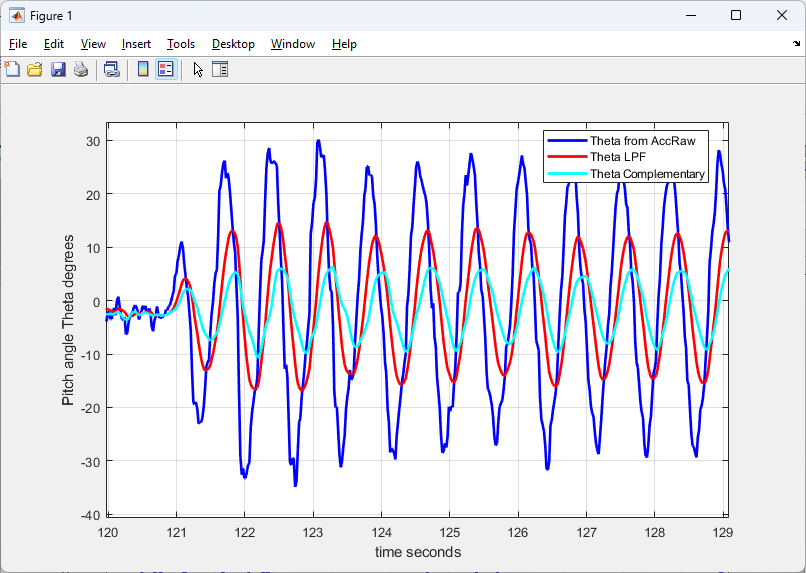
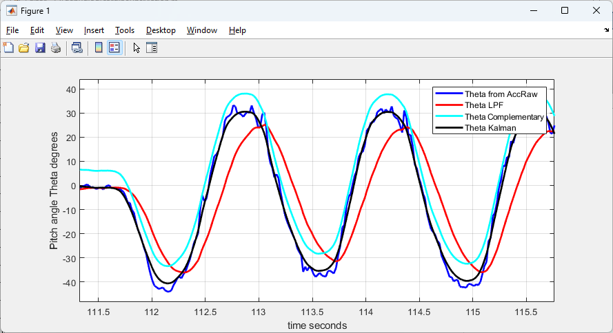
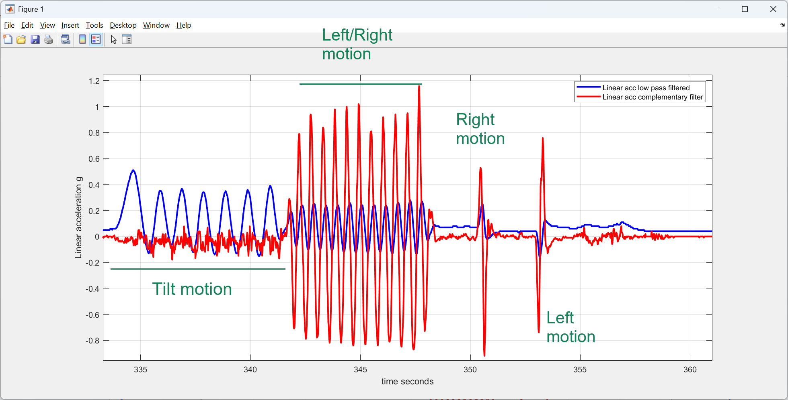
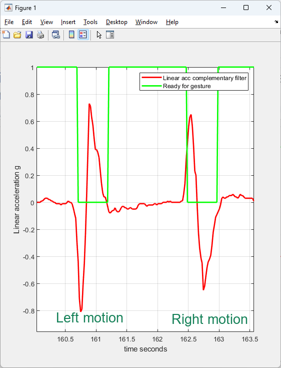

What was this project:

  Basically, in this part of the drone project, I wanted a better way to tell how my hand (with the IMU in it) is tilted, and a better way to detect when it moves left, right, forward, backward, up, or down. In my first version (IMU_drone_control_readings_with_low_pass_filter) I only used a low pass filter on the acceleration. It worked, but I wanted to see if I could get a cleaner signal with less lag, and one that doesn't get fooled when I just tilt the IMU. So I tried a complementary filter, which mixes the gyroscope and the accelerometer, and I also added a short "lockout" after each detected motion so one hand movement doesn't count as two. I also tried a Kalman filter to compare against, but the Kalman filter part is still very experimental. I still need to understand it better, and I need to do more tests so I can tune its noise settings.

How did I build this Project:

  I used the same Adafruit BNO055 IMU on an Arduino, and I wrote one sketch (IMU_drone_control_readings_with_CompFilerPlusLockout.ino). When it starts, it waits until the IMU's accelerometer and gyroscope are fully calibrated, and prints the calibration status while it waits. Then it runs about 100 times a second and calculates the tilt (pitch and roll) four different ways so I could compare them on the same data. The first way is just the accelerometer: I get the angle from the direction of gravity using atan2, but it is really noisy. The second way is a low pass filter, where the new angle is 90% of the old angle plus 10% of the new accelerometer angle (it is smooth but it lags behind). The third way is a complementary filter, where I take the old angle, add the gyroscope's rotation speed times the time step, and then keep 95% of that and mix in 5% of the accelerometer angle. The gyroscope is good for fast changes and the accelerometer fixes the slow drift, so together they are smooth without lagging. The fourth way is my own 2-state Kalman filter (MyInsKalman.h) that estimates the angle and the gyroscope's bias at the same time. This one is very experimental: its process noise and measurement noise variances (the numbers that tell it how much to trust the gyroscope versus the accelerometer) are just starting values that I haven't tuned yet. After that, I use the complementary filter's tilt to figure out how much of the accelerometer reading is just gravity, and I subtract it to get the "linear acceleration" in g for the x, y, and z directions. If the linear acceleration goes past about 0.15 to 0.2 g (it depends on the direction), the sketch prints that a motion was detected (right, left, forward, backward, up, or down). Right after it detects a motion, it ignores new motions for 25 samples (250 milliseconds) so it can ignore the slow-down at the end of the movement. The sketch also prints all of the numbers as one line of commas, and I copied them into MATLAB to make the plots below.

What I found:

  When the IMU is just sitting still, the raw accelerometer angle (dark blue) is very noisy, and both of the filters make it a lot smoother.

  When I tilted the IMU back and forth, the low pass filter (red) is smooth but it is always late and it never reaches the top of the peaks. The complementary filter (light blue) follows the real motion just as fast as the accelerometer, but with a lot less noise. So the low pass filter trades lag for smoothness, and the complementary filter doesn't have to.

  When I jerked or bumped the IMU, the complementary filter reacted much less than the accelerometer-only angle did.

  When I shook the IMU side to side, the accelerometer-only angle swung about 30 degrees either way, the low pass filter about 15 degrees, and the complementary filter much less (roughly 5 to 10 degrees).

  For the Kalman filter test, I let the gyroscope have an offset (a bias). The complementary filter's angle then sat about 7 degrees too high (the light blue line), because it trusts the gyroscope over short times. My Kalman filter figured out the offset and stayed close to the right answer (the black line). These Kalman results are only from a few early tests with untuned settings, so I can't say yet how well it really works. I need to run more tests before I trust it.

  This plot shows the left/right acceleration. The blue line uses the low pass filter's tilt to take out gravity, and the red line uses the complementary filter's tilt. In the first part, I was only tilting the IMU (before about 341 seconds), and the blue line shows bumps of 0.3 to 0.5 g, even though I wasn't really moving it sideways. The red line barely moves. Then, when I actually move it left and right, the red line shows it clearly.

  This plot shows the "Ready for gesture" signal (green) turning off for 250 milliseconds after each motion. Without that lockout, the slow down at the end of a left motion looked like a right motion, and the other way around.

  Here is a video of it working: https://youtube.com/shorts/QBpUvBzy3HY

Challenges:

  The first problem was the lag from the low pass filter. If I made it smoother, it got even later, and if I made it faster, the noise came back. The complementary filter fixed that. The second problem was that tilting the IMU looked like moving it sideways, because gravity gets split onto different axes when it is tilted. So I needed a good tilt estimate to subtract gravity, and the complementary filter's tilt worked better than the low pass filter's. The third problem was that after I detected a motion, the slow down at the end looked like a motion in the opposite direction, so the drone would have gone the wrong way. Adding the 250 millisecond lockout fixed that. The last problem is the gyroscope's bias. The complementary filter can end up off by a few degrees if the gyroscope has an offset, and in my sketch I set the bias to 0, so I tried the Kalman filter to see if it could estimate it. But the Kalman filter is a challenge by itself: I am still learning how it works, and I don't fully understand how to pick its process noise and measurement noise variances yet.

What I am going to Improve:

  This sketch is a separate test version, and it is not hooked up to the drone yet. It prints "MOTION DETECTED" messages and a different set of numbers than the low pass filter sketch that final_product.py reads, and it doesn't have the hover and land buttons. So my next step is to feed the complementary filter's output into the neural network (instead of the low pass filtered acceleration) and see if the drone follows my hand better. The Kalman filter is still very experimental, so I want to learn it properly first, and make sure I understand every step (predict, update, and what the covariance matrix means). Then I want to do more tests with the IMU still, tilting, and shaking, and use that data to optimize the process noise and measurement noise variances, instead of using starting values. After that, I can compare it more carefully with the complementary filter. I also want to use the BNO055's built in fusion output as another thing to compare against.

What I used:

  Arduino [board], Adafruit BNO055 IMU, and the Arduino libraries Adafruit BNO055 and Adafruit Unified Sensor. I used MATLAB for the plots. To run it, upload IMU_drone_control_readings_with_CompFilerPlusLockout.ino (keep MyInsKalman.h in the same folder), open the Serial Monitor at 115200 baud, and move the IMU around.
